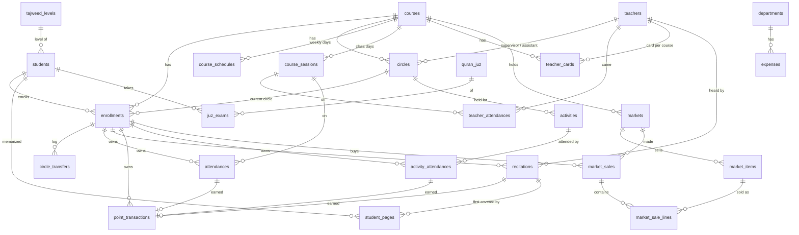

# The domain and its data

This page explains what the tables mean and the rules the mosque asked for. The rule itself is always in the code (the class is named next to each rule); this page is the map.

## The tables

The same tables as plain SQL are in [erd.sql](erd.sql), for MySQL Workbench (File → Import → Reverse Engineer MySQL Create Script). It is a picture to read, not a way to create the database: the migrations do that, and a new migration means a new line in that file too.



Also: `users` (the admin), `settings` (key/value), `notifications` (the bell of the panel).

Every foreign key is `RESTRICT` on delete unless the child has no meaning without its parent (a schedule line, a transfer log line, a memorized page, the list of who attended an activity, the points of an attendance). The database therefore refuses to lose history even if a bug asked it to; the actions give the friendly message first.

## The enrollment is the centre

An **enrollment** is one student in one course (`enrollments`, unique on `student_id + course_id`). It holds:

- `circle_id`: the circle the student is in **now**;
- `card_code`: the digits printed as a QR code on the attendance card. A student gets a new card for every course;
- `enrolled_on`, and `left_on` when the student left the course.

Attendance, recitations, activities attended and points all point to the enrollment. That one choice gives the mosque three things it asked for:

- **Traceability per course.** Every page and point is known to belong to a course, because its owner is "this student in this course".
- **Transfers that cost nothing.** Moving a student changes `enrollments.circle_id` and adds a line to `circle_transfers`. Nothing else moves, and everything the student did shows under the new circle from then on. The log is for reading only; no report is computed from it.
- **One total counter.** `students.recited_pages_count` counts the distinct pages the student recited across all courses.

Rules, and where they are:

| Rule | Class |
|---|---|
| The admin always picks the circle; nobody is placed automatically | `EnrollmentRequest` |
| Not twice in the same course; not into a finished course or an inactive circle; not an archived student | `Actions\Enrollments\EnrollStudent` |
| A transfer stays inside the course, and its date must be typed (no default) | `TransferRequest`, `TransferStudent` |
| Nothing may be recorded outside the course dates or outside `enrolled_on … left_on` | `Services\Enrollments\EnrollmentCalendar` |
| Changing those dates may not leave existing records outside the period | `UpdateEnrollmentDates` |
| An enrollment with history is never deleted: record `left_on` instead | `DeleteEnrollment` |

## Students and teachers

Only the **name** is needed to register a student. `is_profile_complete` is recomputed on every save by `Services\Students\ProfileCompleteness`: it is true once birth date, both phone numbers, address, tajweed level and prior memorized pages all have a value (zero counts as a value). The panel marks incomplete profiles and reminds the admin every few days.

A student with history is **archived** (`archived_at`), never deleted. Only a student with no record at all can be deleted (`DeleteStudent`).

A **photo** is optional and says nothing about whether the profile is complete. The picture is a file in the private folder `student-photos` (`Services\Students\StudentPhotos`), `students.photo_path` holds its name, and only the signed-in admin is handed it (`StudentPhotoController`). The form cuts it square and shrinks it in the browser; `SaveStudent` checks that the file really is a JPG, PNG or WebP by looking inside it (`Support\PictureFile`, no image extension of PHP needed). Every new photo gets a new file name, so its address changes and no browser shows the old one. It appears in the students list (once any student has one), in the student's file, in the answer of the scan screen and on the printed card.

The other pictures are kept the same way, each in a folder of its own (`Services\Files\KeptPictures` holds what they share): the **teacher's photo** (`teacher-photos`, `TeacherPhotos`, `teachers.photo_path`, handed out by `TeacherPhotoController`) the **circle's logo** (`circle-logos`, `CircleLogos`, `circles.logo_path`, `CircleLogoController`) and the **picture of a market's item** (`market-items`, `MarketItemPictures`, `market_items.image_path`, `MarketItemPictureController`). A folder only ever reads or removes names of its own form, so one kind of picture can never touch another.

`prior_memorized_pages` is what the student had memorized before joining. It is a number only: the system does not know *which* pages. `Student::memorized_pages_total` adds it to `recited_pages_count` for display.

There is **one list of teachers**. Circle supervisors, assistants, the teacher who hears a recitation and the examiner are all picked from it. A teacher who appears in any record (attendance included) is deactivated, not deleted. Changing a circle's supervisor is a plain replacement; no history of it is kept.

A teacher has an **attendance card per course**, like a student (`teacher_cards`: course, teacher, `card_code`, unique per course and teacher). It is given by `Services\Teachers\TeacherCards` the first time the cards of that course are printed, and kept for the whole course. Codes are never shared between a teacher's card and an enrollment (`NumericCardCodeGenerator` checks both tables).

## Courses, circles and class days

A course has dates, a weekly timetable (`course_schedules`: weekday, from, to) and two point rates: `points_per_page` and `points_per_attendance`.

A **session** (`course_sessions`) is one class day of a course. Sessions are not created in advance:

- the first attendance of a scheduled day opens the session (`Services\Attendance\SessionResolver`);
- the admin can open an **exceptional** session on a day outside the timetable (`OpenSession`);
- the admin can **cancel** a session that was a holiday, so it counts against nobody (`CancelSession`); a session that already has attendance must have it removed first.

**Attendance rate** = sessions the student attended ÷ sessions with status `held` that fall inside the student's enrollment period (`StudentStandings::heldSessions()`).

## Attendance

The USB scanner behaves like a keyboard: it types the digits of the card and presses Enter. `Filament\Pages\ScanAttendance` is one text box that is always focused, and `RecordScanAttendance` answers every scan with a `ScanStatus`:

| Status | Meaning |
|---|---|
| `recorded` | attendance saved, points awarded |
| `already_recorded` | the same card again today |
| `unknown_card` | no enrollment has this code |
| `inactive_enrollment` | the student left the course or is archived |
| `course_not_running` | the course is finished or today is outside its dates |
| `not_scheduled_day` | today is not a class day; the screen offers to open an exceptional session (`ScanIntoExceptionalSession`) |
| `session_cancelled` | today's session was cancelled |

A scan is always for **today**. Attendance for another date is added by hand (`RecordManualAttendance`), earns the same points, and opens that day's session if needed.

Card codes are 10 random digits (`NumericCardCodeGenerator`): digits survive an Arabic keyboard layout, and random codes cannot be guessed from the next card.

### The teachers' attendance

The supervisor and the assistant of a circle scan **their card of the course at the same desk** (`Actions\Attendance\ScanCard` looks for a teacher's card with that code first, then for an enrollment). `RecordTeacherScan` records one line in `teacher_attendances` (unique on `course_session_id + teacher_id`, method `qr`, the time of the scan) in today's session of **the card's course only**, as long as the course is running and the teacher still supervises or assists an active circle of it (`Services\Teachers\TeacherCircles::inCourse`). A teacher of two courses at the same time has two cards. The session follows the students' rules (`SessionResolver::forScan`). Two more statuses (and `course_not_running` for a card of a course that is over):

| Status | Meaning |
|---|---|
| `inactive_teacher` | the teacher was deactivated |
| `teacher_without_circle` | the teacher no longer supervises or assists an active circle of the card's course |

On a day without class the same "open an exceptional session" button opens today's session of the card's course (`ScanIntoExceptionalSession`).

A forgotten card is added by hand on the page حضور الأساتذة (`RecordManualTeacherAttendance`): a course in which the teacher has a circle, a day inside it, never in the future, once per day. Teachers earn no points. A session with a teacher's attendance cannot be cancelled, like one with a student's.

The statistics page has a part for it (`TeacherAttendanceStandings`): for each supervisor and assistant of the circles in the scope, the sessions held in their courses, those attended, the rate and the last day. Circles keep no history of who taught them when, so a teacher given a circle in the middle of a course is expected from its first session.

## Attendance cards

A student's card belongs to an enrollment, so a student gets a new card for every course. `Actions\Cards\PrepareAttendanceCards` builds the cards of a course, of one circle or of chosen students; `AttendanceCardController` prints them. A teacher's card belongs to a course too (`PrepareTeacherCards`, `TeacherCardController`): the cards of a course are those of every teacher who supervises or assists an active circle of it, or of chosen ones. A teacher's card has **no circle**: the photo, the name, the course's name (smaller, where the circle's band would be), the mosque's logo and the QR code, which stands in the middle (`public/img/card/background-teacher.png` is the design without the green band of the circle).

The card is the designer's Photoshop file, drawn exactly (`resources/views/cards/badge.blade.php`): 54 × 86 mm, upright, an SVG whose units are the pixels of the PSD (638 × 1016 at 300 ppi).

- **The fixed part** is one picture, `public/img/card/background.png`: Photoshop's own flattened image of the PSD (its CMYK converted with Coated FOGRA39), with the parts that change taken out and the background put back. The mosque's logo, the frames and the bands are in it.
- **What changes**, at the places and in the styles of the PSD: the photo cut to the scalloped frame (`public/img/card/photo-mask.png`; a grey figure without a photo), the name (13 pt, `CardDesign::INK`), the circle's name (white, in the green band), the QR code (bottom left, in the green of the design, without the white border: the frame of the design is its quiet zone) and the circle's logo (bottom right, with the design's drop shadow).
- **Numbers** are drawn 0-9 like everywhere in the system: that font draws them as Arabic-Indic digits, so `CardFont::withLatinDigits()` puts them in the panel's font.
- **The font** is GE Dinar One Medium, which the system cannot ship: `Support\CardFont` uses the file the mosque puts in `public/fonts/card/` (`card.woff2`, `card.woff`, `card.ttf` or `card.otf`), or the font installed on the computer, and falls back to the panel's font.
- **The page** shrinks a name too long for its band on its own baseline (never cuts it), and shows a logo without its see-through margins, as Photoshop placed it.
- **Paper.** `Enums\CardPaper`: `sheet` lays 3 × 3 cards on A4 pages with a hairline to cut along (`CardDesign::cardsPerSheet()`), `single` prints each card on a page of its own size for a card printer. It is a choice on the print page (`?paper=single`), not a stored setting.

The pictures are SVG `<image>`s, not CSS backgrounds, because browsers leave backgrounds out when printing.

## Recitation and memorized pages

A recitation is a range of pages (`from_page … to_page`, 1 to 604, the Madinah mushaf) that a teacher heard on a day, stored on the enrollment.

`Services\Memorization\MemorizationLedger` is the single source of truth for what a student has memorized:

- a page belongs to the **earliest** recitation that covers it (by date, then by entry order);
- `recitations.new_pages_count` is how many pages that recitation was the first to cover; a repeated page is never counted twice;
- `student_pages` holds one row per memorized page with the recitation that owns it;
- `students.recited_pages_count` is the number of those rows.

After a recitation is added, corrected or deleted, the ledger **rebuilds that one student** from all their recitations, in one transaction, and brings the points and exams in line. Do not write to `student_pages`, `new_pages_count` or `recited_pages_count` from anywhere else.

## Juz exams

`quran_juz` holds the page range of each of the 30 juz. It is filled by its migration (not a seeder) because the system does not work without it.

`Services\Memorization\JuzExamSynchronizer` runs at the end of every ledger rebuild:

- a juz whose every page is memorized, and that has no exam yet, gets a **pending** exam with origin `auto`; the event `JuzExamOpened` notifies the admin;
- a pending `auto` exam is withdrawn if its juz is no longer complete (the recitation was corrected or deleted);
- exams opened by hand (`origin = manual`: a juz memorized before joining, or a retake) and exams already taken are never touched.

The result (date, examiner, grade) is entered by `RecordJuzExamResult`. Grades are in `Enums\ExamGrade`.

## Activities

An activity is something outside the lessons: a trip, a competition, a meeting. `activities` holds its name, its date, the points each student who attended gains (zero for none), and `circle_id`: the circle it was held for, or `NULL` for an activity of the **whole mosque** (`Enums\ActivityAudience` names the two; it is not a column).

`activity_attendances` lists who attended, one row per enrollment. The points follow from it: `Actions\Activities\SaveActivity` saves the activity and its list in one step and has `PointsLedger::syncForActivityAttendance()` make every listed student's points what the activity gives now. Change the points, the date or the name of the activity and every line follows; take a student off the list and their line goes with the row.

| Rule | Where |
|---|---|
| An activity is recorded after it took place: its date is never in the future | `ActivityRequest` |
| A circle's activity takes students of that circle's course, on a date inside the course | `SaveActivity` (`activity.other_course`, `activity.outside_course`) |
| A mosque activity takes any student of a running course. A student of two courses attends once, as a student of one of them | `SaveActivity` (`activity.student_twice`); the list on offer is `Filament\Support\Options::activityAttendees()` |
| Nobody attends before joining their course or after leaving it; the message names the student | `EnrollmentCalendar`, wrapped by `SaveActivity` |
| An archived student is not added, but stays on a list they are already on | `SaveActivity` (`student.archived`) |
| Deleting an activity deletes its list and the points it gave | `DeleteActivity` (the foreign keys cascade) |
| An enrollment that attended an activity, and a circle that has one, are not deleted; a course's dates cannot be moved off its activities | `DeleteEnrollment`, `DeleteCircle`, `DeleteCourse`, `SaveCourse` |

Attending an activity is not class attendance: it does not touch `attendances`, sessions or attendance rates. It only gives points, which every report counts like any other point.

## Points

`point_transactions` is a ledger; `Services\Points\PointsLedger` is its only writer.

| Source | Amount | Tied to |
|---|---|---|
| `attendance` | the course's `points_per_attendance` at that moment | the attendance row (`attendance_id`, unique) |
| `recitation` | `new_pages_count × points_per_page` | the recitation row (`recitation_id`, unique) |
| `activity` | the activity's `points`; the line's reason is the activity's name | the row of the student in the activity (`activity_attendance_id`, unique) |
| `manual` | what the admin typed, negative for a penalty, with a reason | nothing |

Automatic points follow the row that earned them: correcting or deleting the attendance, the recitation or the activity corrects the points (the foreign keys cascade, and the ledger re-syncs recitation and activity points whenever their source is saved). The page rate is **frozen on the recitation** when it is entered, so changing a course's rate later never rewrites old points.

## The points market

A course holds as many **markets** (سوق النقاط) as it likes; each offers **items** (name, optional description and picture, a price in points, an optional stock: what is left to sell). Only an open market sells; a closed one keeps its items and its sales.

**Spending does not touch the ledger.** A student's balance in a course is what they earned there (`point_transactions`) minus what they bought at the course's markets (`market_sales.total_points`): `Services\Market\PointsBalance`. The statistics, the Quran Knight and the slides keep counting what was earned (the user's choice). The balance can fall below zero when points are taken back after a purchase (a corrected recitation, a penalty); it then simply covers nothing.

| Rule | Where |
|---|---|
| The sales desk sells a basket to a scanned card: a current student (not left, not archived) of the market's course, at an open market, for items still offered and in stock, if the balance covers the whole basket. All or nothing | `Market\SellToCard` |
| Expected refusals are results, not exceptions (unknown card, teacher's card, another course, not enough points, out of stock...); a scan with an empty basket shows the balance | `SaleResult`, `Enums\SaleStatus` |
| The student and the items are locked while a sale is checked and written: a card scanned twice cannot spend the same points twice, and the last item cannot be sold twice | `SellToCard` |
| A sale keeps each item's name and price as sold | `market_sale_lines` |
| A cancelled sale gives the points and the stock back | `CancelSale` |
| An item that was sold is not deleted (taken off the desk instead); a market with sales is not deleted (closed instead); a course with a market is not deleted | `DeleteMarketItem`, `DeleteMarket`, `DeleteCourse` |
| Item pictures are kept like the students' photos and travel with backups | `Services\Market\MarketItemPictures`, `KeptFiles` |

## Statistics, rankings and slides

All in `app/Services/Statistics`. The base is `StudentStandings`: one row per student in a course with attendance, pages and points, computed in a single query for a `ReportFilter` (course, circle, period). Circles, courses, totals and rankings are sums or orderings of those rows, so the numbers of different reports always agree.

- A circle's figures are the sum of what its **current** students did, including what they did before being moved to it.
- `Support\Ranking`: equal scores share a place (1, 1, 3).
- `QuranKnight` (الفارس القرآني): who recited the most **new** pages in a period, in the mosque, a course or a circle.
- `CircleLeaders`: the best N students of each circle, by new pages or by points. This is what the slides show. Its doc comment lists the tie-breaking rules.

**Slides.** `Actions\Export\ExportLeadersSlides` fills a PowerPoint template, one slide per circle, set to advance and loop by themselves. The template is a `.pptx` with one slide carrying placeholders such as `{{circle}}`, `{{name1}}`, `{{score1}}`; `Services\Export\LeadersSlides` lists them all. Shapes named `slot2`, `slot3`, ... are removed when the circle has fewer leaders. The default designs are `resources/pptx/leaders-1.pptx` to `leaders-10.pptx`; the admin can upload their own from the settings page, and it then travels with every backup.

`Services\Export\Pptx` edits the `.pptx` directly (a ZIP of XML files) with PHP's `ZipArchive`. There is no PowerPoint library.

## Finance

Expenses only: there is no income and no balance. Every amount is in **Syrian pounds** (`Money::CURRENCY`, ل.س; `Money::pounds()` writes an amount with it, and the piastres only when there are some).

An expense has a department, a date and one of two shapes (`Enums\ExpenseKind`):

- **Itemized**: an item name, a quantity (3 decimals) and a unit price. **The total is never typed**: `SaveExpense` computes it with `Support\Money`.
- **Lump sum**: a description (in `item_name`) and the amount paid, for several things bought at once whose items and quantities nobody kept. `quantity` and `unit_price` are null; the total is the amount. `Expense::$kind` tells the two apart (no quantity = lump sum).

`Services\Finance\ExpenseReport` gives the total and its split by department, month and item. Lump sums count in every total but not in the top items, since they are not items.

A department with expenses is deactivated, not deleted.

## Backups

A backup is a ZIP in the backups folder (`backups/` next to `start.bat`, or `RAWDA_BACKUPS_PATH`):

```
manifest.json   what it is, when, the SHA-256 of each part, row counts, the migrations the database had run
database.sql    the whole database, as SQL that MySQL Workbench can also import
files/...       the files that are not in the database (see below)
```

The files are everything in five folders of the private disk (`Services\Backup\KeptFiles`): `slide-templates` (the admin's own slide design), `student-photos`, `teacher-photos`, `circle-logos` and `market-items`. A restore makes those folders hold exactly what the backup has; a file of any other folder in an older backup (the retired `card-design`) is left out. Photos make a backup larger: about the size of the photos themselves, in every backup.

The file name says when and why: `rawda-backup-2026-10-07_170000-auto.zip`. Kinds (`Enums\BackupKind`): `auto` (daily, the newest 30 are kept), `manual`, `before-restore`, `before-update`, `uploaded`.

**Restore** (`Actions\Backups\RestoreBackup`) is careful twice: `BackupInspector` checks the file from end to end before anything is touched (fingerprints, every SQL line, and that it was not made by a newer version), and a `before-restore` backup of the present state is taken first and put back if the restore fails half-way. After loading, the migrations the backup did not have are run, which is why **a shipped migration must never be edited**.

## The demo

`demo.bat` runs the same code on the database `rawda_demo`, with its own backups folder, uploads folder, session cookie and cache prefix, on port 8010. `php artisan rawda:demo` fills it from `database/seeders/DemoSeeder.php` and refuses any database whose name does not end with `_demo`.

The demo's account is `App\Services\Demo\DemoAccount`. It exists only in demo databases and is shown on the demo's sign-in page. **The real system has no seeded account**: the admin is created by the person who installs it, at `/setup` or with `php artisan rawda:admin`.

## Settings of the mosque

Table `settings`, read through `SettingsStore`, keys in `Support\SettingKey`: the mosque's name (shown beside the logo at the top of the panel, on the home page, on the letterhead of the reports and on the slides), the number of days between reminders about incomplete profiles, and two dates the system keeps for itself.

## The mosque's logo

The logo is one file of the application, `public/img/logo.png` (see-through background), read through `Support\Brand` with the mosque's name. It is on every page of the panel and above the sign-in form (the panel's brand), at the top of the home page (`Widgets\MosqueBanner`), on the letterhead of every report (`Widgets\Reports\Letterhead`: the report, what its filter covers, the day; a report prints with it, without the menu and the filter), on the setup page, on the card print page, baked into the card, and in the default slide templates (run `resources/pptx/build-default-templates.js` again after changing the logo). `public/img/favicon.png` is the browser tab's icon.

## Open questions from the plan

These were never answered by the mosque, and the system works with the simple choice until they are: whether the scanner reads QR or only 1D codes, half pages, grading scale and points for exams, lateness, the currency label, the names of the tajweed levels, and the card size (answered: the designer's 54 × 86 mm). If one is answered, start from the class named in the matching section above.
